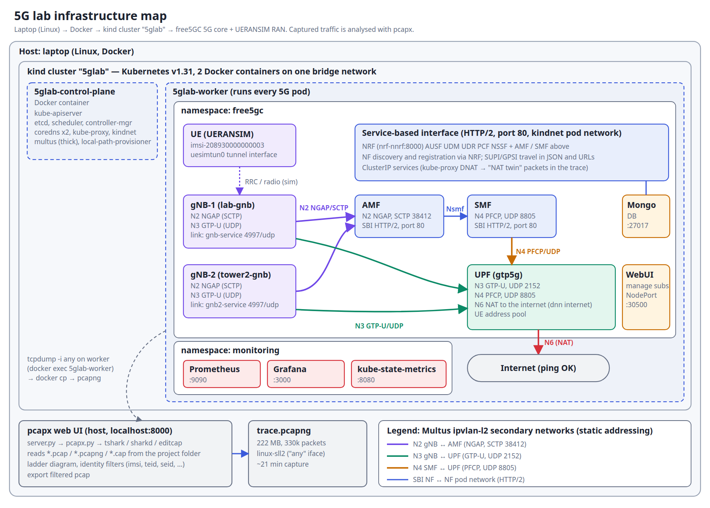
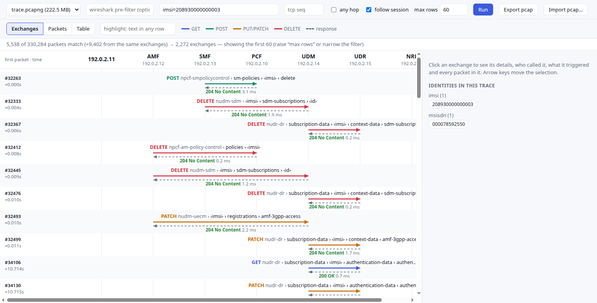
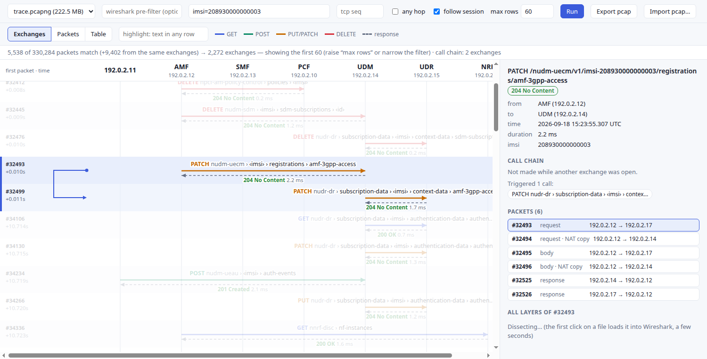
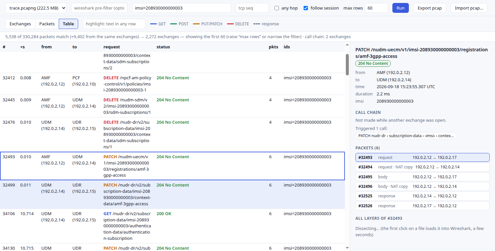

# pcapx – 5G packet-flow explorer

A small local web UI (plus CLI) on top of `tshark` for exploring 5G core captures. It finds every packet that
belongs to a subscriber (IMSI / MSISDN / IMEI) or a session handle (TEID, SEID, UE NGAP ID, TCAP TID, SIP Call-ID,
Diameter Session-Id), and draws the result as a ladder diagram, one row per HTTP/2 request+response.

The captures come from a local 5G lab (free5GC + UERANSIM on a kind cluster). The map below shows what is being captured.



Vector version: [`infra_map.svg`](infra_map.svg). The map contains no IP addresses. Every address in this README and
in the screenshots is a dummy from the documentation ranges (`192.0.2.0/24`, `198.51.100.0/24`, `203.0.113.0/24`,
`198.18.0.0/15`), not a real one.

## Screenshots

The captures below are a 222 MB, 330k-packet lab trace imported through the UI. IP addresses in the screenshots
are replaced by dummy documentation-range addresses.

**1. Import.** Press **Import pcap…** (or drop the file on the page). The file is stored, selected in the drop-down,
and ready to run.


**2. Exchanges.** Filter on a subscriber (`imsi=...`) with *follow session* on. One row per HTTP/2 request and
response, lanes named by network function. The side panel lists the identities found in the trace.



**3. Details.** Click an exchange to see who called whom, timing, the call chain (what triggered it, what it
triggered) and every packet in it, including the NAT copies.



**4. Table.** The same exchanges as a sortable table.



## Files

| File | Purpose |
|---|---|
| `server.py` | Web server on `localhost:8000`. Serves the UI and `/api/*`, keeps one `sharkd` per pcap for full frame dissection |
| `pcapx.py` | Parser, filter language, correlation, graph builder, CLI |
| `graph_template.html` | The UI (also used for static HTML export via `--graph`) |
| `docs/` | Screenshots used in this README |
| `infra_map.svg` / `.png` | Infrastructure map |

Requirements: Python 3.8+, and `tshark`, `sharkd`, `editcap`, `mergecap` (all shipped with the Wireshark packages;
`sudo apt install tshark wireshark-common`). No Python packages needed.

## Run the app

```bash
cd /home/hele/Documents/Claude/whireshark
python3 server.py                     # http://localhost:8000, pcaps from this folder
python3 server.py --dir ~/captures    # pcaps from another folder
python3 server.py --port 8080         # another port
python3 server.py --max-upload-mb 8192  # allow bigger imports (default 2048)
```

Open <http://localhost:8000>, pick a file in the drop-down, type a filter, press the query button.
Stop it with `Ctrl-C` (or `pkill -f server.py` if it runs in the background).

## Import a pcap

**In the UI:** press **Import pcap…** in the toolbar and choose a `.pcap`, `.pcapng` or `.cap` file, or drag the
file anywhere onto the page. A progress readout shows the upload; when it finishes the file is selected in the
drop-down, and you press **Run**.

- The server checks the file header, so a compressed or renamed non-capture is rejected with a message
  (unzip `.gz` files first).
- An existing capture is never overwritten: a second `lab.pcap` is stored as `lab_1.pcap`.
- Uploads stream to disk in 1 MB chunks (a 222 MB trace takes about a second locally and uses no extra memory).
  The default size limit is 2048 MB, change it with `python3 server.py --max-upload-mb 8192`.
- Files land in the server's folder (the project folder, or `--dir`).

You can also put a file into that folder by hand (below). The UI picks it up on the next page load.

### 1. You already have a capture file (Wireshark, tcpdump, a colleague, a bug report)

```bash
cp ~/Downloads/incident.pcapng /home/hele/Documents/Claude/whireshark/
```

Reload the page. The file list is read on page load, so the file shows up without restarting the server.
Files with other extensions (`.pcap.gz`, `.snoop`, `.dmp`, ...) are ignored. Convert or unpack them first:

```bash
gunzip incident.pcap.gz                                    # compressed
editcap -F pcapng weird_format.snoop incident.pcapng       # other formats -> pcapng
```

Names must be plain file names (no sub-folders): the server rejects anything with a `/` in it.

### 2. Capture fresh traffic from the lab

The lab runs in two Docker containers (`5glab-worker`, `5glab-control-plane`). Every 5G pod is on the worker,
and the worker has `tcpdump`. Capturing on interface `any` there sees SBI (HTTP/2), N2 (NGAP), N3 (GTP-U),
N4 (PFCP), MongoDB and the Kubernetes NAT (before/after kube-proxy) in one file.

```bash
cd /home/hele/Documents/Claude/whireshark

# 60 second capture streamed straight to a file on the host
docker exec 5glab-worker timeout -s INT 60 tcpdump -i any -s 0 -U -w - > lab_$(date +%Y%m%d_%H%M).pcap
```

- While it runs, generate the traffic you want to look at, for example restart the UE so it registers and opens a
  PDU session: `kubectl -n free5gc rollout restart deploy/ueransim-lab-ue`.
- Stream to stdout (`-w -`) as above instead of writing a file in the node and using `docker cp`.
  The node's `/tmp` is a tmpfs, and `docker cp` cannot read it (`Could not find the file /tmp/...`).
- Narrow the capture on the wire to keep files small, for example only the 5G control/user-plane protocols:
  `... tcpdump -i any -s 0 -U -w - 'sctp or udp port 8805 or udp port 2152 or tcp port 80' > lab.pcap`.
  Careful: this also drops the MongoDB and DNS traffic.
- `-s 0` keeps full packets. Without it tcpdump may truncate them and HTTP/2 / JSON will not decode.

### 3. Capture from a single pod (optional)

Most NF images have no `tcpdump`, so attach a debug container that shares the pod's network namespace
(standard `kubectl debug` usage, not tried in this lab):

```bash
kubectl -n free5gc debug -it deploy/free5gc-lab-free5gc-smf-smf --image=nicolaka/netshoot --target=smf -- \
  tcpdump -i any -s 0 -U -w - > smf.pcap
```

Use this when you only want one NF's view, which also avoids duplicate "NAT twin" packets.

### 4. Big captures (hundreds of MB)

The first query of a file parses the whole capture and keeps the result in memory (a 222 MB / 330k-packet capture takes
about 15 s). Later queries on the same file and pre-filter are instant. To keep it fast:

- Fill the **pre-filter** box in the UI (or `--pre` on the CLI) with a native Wireshark display filter.
  It is applied by `tshark` before parsing, so it is much cheaper than the pcapx filter:
  `ip.addr==192.0.2.22 or sctp or pfcp or gtp`
- Or cut the file down first:
  ```bash
  editcap -A "2026-09-24 10:11:00" -B "2026-09-24 10:12:00" capture.pcapng slice.pcapng   # time window
  tshark -r capture.pcapng -Y "pfcp or ngap" -w control_plane.pcapng                        # protocols
  ```
- Changing a file (its modification time) invalidates the cache automatically.

### 5. Check the import worked

```bash
python3 pcapx.py lab.pcap --stats        # lists the identities found (imsi, msisdn, teid, seid, ue_id, ...)
capinfos lab.pcap                        # packet count, duration, link type
```

If `--stats` prints nothing, the capture has no subscriber identities. It may be idle traffic, the wrong time window,
or the registration was not captured. Restart the UE during the capture.
Then in the UI select the file and run a first query, for example `imsi=208930000000003`.

## Filter language

`key=value`, `key!=value`, `key~=regex`, joined with `and` / `or`. `*` is a wildcard for `=`.
Identity values are normalised, so `imsi-2089...`, `+49151...` and TBCD digits all compare equal.

```text
imsi=208930000000003
msisdn=4915112345678 and proto~=NGAP|HTTP2
imsi=2089*                       # wildcard
```

Options in the UI (and CLI flags):

| Option | Effect |
|---|---|
| follow (`--follow`) | Grow the match to everything tied to the same subscriber: IMSI → NGAP UE IDs → PFCP SEID → GTP TEID → user-plane packets |
| seq / any-hop (`--seq N --any-hop`) | Find a TCP sequence number, and the same payload elsewhere (NAT, proxy) even when seq or ports differ |
| pre-filter (`--pre`) | Native Wireshark filter applied first (speed) |
| max rows (`--max-rows`) | Limit the diagram (default 300, max 2000) |
| Export (`-w out.pcapng`) | Write the matching packets to a new capture |

CLI examples:

```bash
python3 pcapx.py capture.pcapng --stats
python3 pcapx.py capture.pcapng -f "imsi=208930000000003" --follow
python3 pcapx.py capture.pcapng -f "imsi=208930000000003" --follow --graph flow.html   # standalone HTML
python3 pcapx.py capture.pcapng -f "imsi=2089*" -w out.pcapng
```

## HTTP API (used by the UI)

| Endpoint | Returns |
|---|---|
| `GET /api/files` | Capture files in the folder |
| `GET /api/ids?file=&pre=` | Identities found in the capture |
| `GET /api/query?file=&f=&seq=&hop=1&follow=1&max=&pre=` | Rows and packets for the diagram |
| `GET /api/frame?file=&frame=` | Full protocol tree and hex of one frame (via `sharkd`) |
| `GET /api/export?...` | `filtered.pcapng` download |
| `POST /api/upload?name=x.pcapng` | Import: body is the raw file, header `X-Requested-With: pcapx` required. Returns `{name, mb}` |

The server only binds to `localhost` and has no authentication. Do not expose it. Captures contain subscriber identities.

## The lab

Kubernetes cluster `5glab` (kind, v1.31): `5glab-control-plane` and `5glab-worker`. Namespaces: `free5gc`
(NRF, AMF, SMF, UPF, AUSF, UDM, UDR, PCF, NSSF, WebUI, MongoDB, 2× gNB, UE), `monitoring` (Prometheus, Grafana, kube-state-metrics).

| Interface | Network | Endpoints |
|---|---|---|
| SBI (HTTP/2, port 80) | kindnet pod network `192.0.2.0/24`, ClusterIP `198.51.100.0/24` | all NFs |
| N2 (NGAP, SCTP 38412) | Multus ipvlan `203.0.113.8/29` | AMF `.9`, gNB-1 `.10`, gNB-2 `.11` |
| N3 (GTP-U, UDP 2152) | Multus ipvlan `203.0.113.16/29` | UPF `.17`, gNB-2 `.18`, gNB-1 `.20` |
| N4 (PFCP, UDP 8805) | Multus ipvlan `203.0.113.24/29` | UPF `.25`, SMF `.28` |
| N6 | Multus ipvlan on the kind bridge | UPF `198.18.0.22`, NAT to the internet, UE pool `198.19.0.0/17` |

Handy access: WebUI NodePort `30500` (on the worker `198.18.0.2`), Grafana and Prometheus are ClusterIP
(`kubectl -n monitoring port-forward svc/grafana 3000`).

### Health check

```bash
kubectl -n free5gc get pods                                                   # all Running, no restarts climbing
kubectl -n free5gc logs deploy/ueransim-lab-ue | grep -E "Registration|PDU Session|uesimtun"
kubectl -n free5gc exec deploy/ueransim-lab-ue -- ping -c 3 -I uesimtun0 <any-public-host>
```

